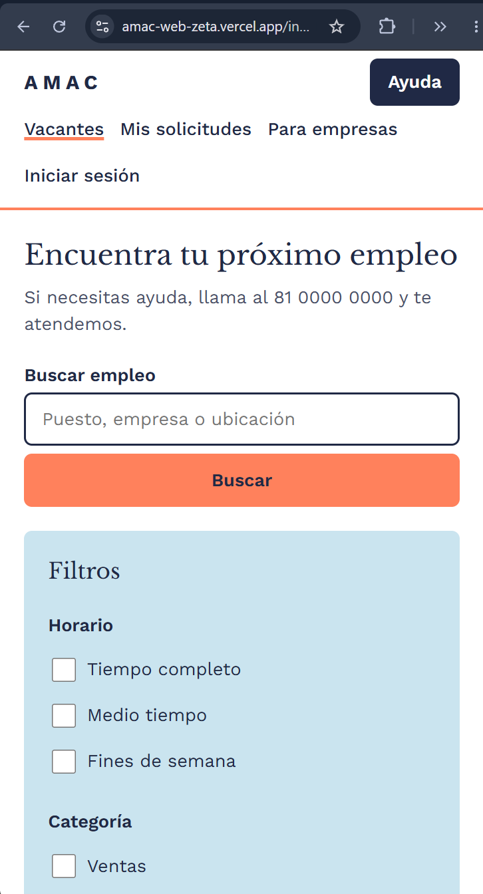
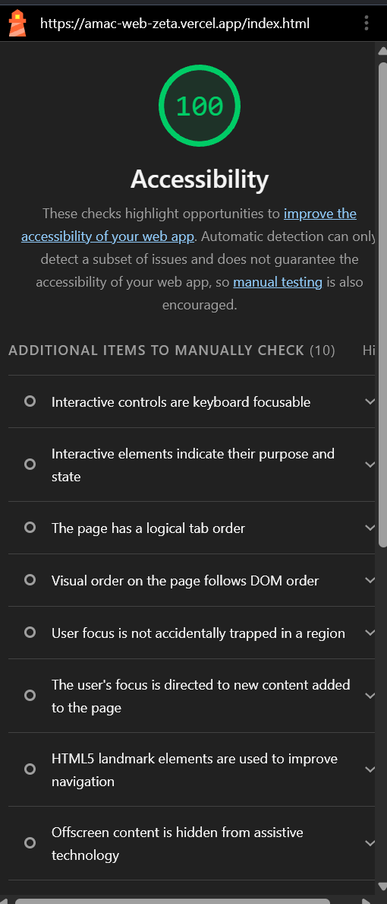

# AMAC - Bolsa de trabajo

Página de empleo para adultos mayores hecha con HTML y CSS.

Sitio: https://amac-web-zeta.vercel.app/

## Integrantes

- Amaury Pérez: los archivos CSS y los estilos de desktop.
- Juan Collado: login, mis solicitudes, vacante, registro y confirmación.
- Carlos Aguilar: index y empresa-vacantes.

## Colores

- Azul marino: #202945
- Coral: #ff815c
- Azul claro: #cae4ef
- Durazno: #fddaad

## Tipografías

- Títulos: Libre Baskerville
- Texto: Work Sans (18 px)

## Componentes

- Botón
- Tarjeta
- Etiqueta de estatus
- Campo de formulario
- Buscador
- Filtros
- Encabezado
- Pie de página

## Capturas

Celular:

Escritorio:

Lighthouse:

